# Splitfire

> **Split the work. Not the codebase.**

Paste a public GitHub repo and a feature request. Splitfire turns it into a collision-proof graph
of tasks that parallel coding agents can run at the same time — each with its own contract,
context pack, model, cost estimate and acceptance checks.

**Live:** https://splitfire-one.vercel.app

## Why

Running several coding agents on one repo fails in four ways: merge conflicts (two agents edit the
same file), idle agents (B waits for A), context bloat (every agent reads the whole repo) and no
proof of done. Splitfire plans around all four before a single agent starts.

## What you get

- **Real import graph** — tree-sitter (WASM) parses TS/JS/Python imports, with a regex fallback.
- **Streaming plan** — an open model proposes tasks; the graph grows node by node over SSE.
- **Collision score 0** — deterministic code gives every file exactly one owner and repairs
  overlaps and dependency cycles. The heatmap shows the draft's clashes and the repaired plan.
- **Contracts-first** — shared types and API surfaces move into a tiny contract task, so a chain
  of waiting tasks becomes one fan-out. Kept only when it shortens the schedule.
- **Speedup** — critical path and agent scheduling: `Serial 4h 15m → 2h 25m with 4 agents (1.8×)`.
- **Context packs** — each task gets its owned files plus their direct imports, not the repo.
- **Model routing + cost** — fast model for easy tasks, strong model for hard ones, per-task cost.
- **Acceptance gates** — checks from the repo's real tooling (vitest/jest/pytest, typecheck, build,
  files that must exist, and "the diff touches only owned files").
- **Export** — copy an Alan-ready prompt per task, download the `.splitfire/` pack, or the plan JSON.
- **Share links** — read-only plan pages at `/p/<planId>`.

## Quick start

Requires Node 20+.

```sh
git clone https://github.com/yugh88/splitfire && cd splitfire
npm install && cp .env.example .env.local && npm run dev
```

Open http://localhost:3000. `.env.example` ships with `MOCK_LLM=1`, so planning is free and needs
no keys. Add a `GITHUB_TOKEN` (any token with public read access) if you hit GitHub's
60-requests-per-hour anonymous limit.

## How it works

```mermaid
flowchart LR
  UI["Browser<br/>Next.js + React Flow"] -- "POST /api/plan" --> API["Route handler<br/>(Node, stateless)"]
  API -- "SSE: ingested · graph · task · partitioned · metrics · done" --> UI
  API --> Ingest["ingest/<br/>GitHub REST, no clone"]
  Ingest --> Analyze["analyze/<br/>tree-sitter import graph"]
  Analyze --> Plan["plan/<br/>LLM proposes tasks<br/>Zod + repair + fallback"]
  Plan --> Partition["partition/<br/>ownership · cycles · contracts · critical path"]
  Partition --> Context["context/<br/>packs · acceptance · exports"]
  Context --> Cost["cost/<br/>routing + estimates"]
  Analyze <--> Store[("Upstash Redis<br/>tree:{repo}@{sha} · plan:{id}<br/>spend:* · ratelimit:*")]
  Cost --> Store
```



**Deterministic core, LLM on the edges.** Parsing, partitioning, collision checks, contracts and
the critical path are plain, unit-tested functions. The model only _proposes_ groupings; code
verifies and repairs them. Every model output goes through validate → retry once with the error →
fallback model → a deterministic plan built from import-graph communities, so a bad answer never
crashes the app.

Other principles: repos are cached by commit SHA; plan ids are
`hash(repo, sha, request, agents, settingsVersion)`, so repeating a request replays the stored plan
for free; no source code is stored, only the plan.

## Credit guards

Splitfire runs on a fixed open-model budget and enforces it in code:

- `CREDIT_BUDGET_USD` (default 5) caps total spend; `PLAN_MAX_COST_USD` (default 0.05) caps one plan.
- Before every call the worst-case cost (input tokens + max output) is checked against both caps
  using `MODEL_PRICES_JSON`; a call that could exceed them is not made. Unpriced models are never called.
- Real usage is added after each call with atomic increments (`spend:total`, `spend:day:{date}`).
- At 90% of the budget every call switches to `FAST_MODEL`; at 100% the deterministic planner takes
  over and the UI says "demo budget reached".
- 5 plans per IP per hour, a 500-file / 2 MB repo cap, and a hard prompt-size cap.
- `GET /api/health` shows spend vs. budget (numbers only).

## Configuration

| Variable                                                  | Purpose                                                              |
| --------------------------------------------------------- | -------------------------------------------------------------------- |
| `OPENMODEL_BASE_URL`, `OPENMODEL_API_KEY`                 | OpenAI-compatible open-model endpoint                                |
| `PLANNER_MODEL`, `FAST_MODEL`                             | Strong and small model ids                                           |
| `FALLBACK_BASE_URL`, `FALLBACK_API_KEY`, `FALLBACK_MODEL` | Fallback endpoint                                                    |
| `MODEL_PRICES_JSON`                                       | USD per 1M tokens per model, e.g. `{"m":{"input":0.6,"output":2.4}}` |
| `CREDIT_BUDGET_USD`, `PLAN_MAX_COST_USD`                  | Spend caps                                                           |
| `MOCK_LLM`                                                | `1` = fixture plans, no model calls                                  |
| `UPSTASH_REDIS_REST_URL`, `UPSTASH_REDIS_REST_TOKEN`      | Plan store, cache, spend, rate limits (in-memory if unset)           |
| `GITHUB_TOKEN`                                            | Optional; raises the GitHub rate limit                               |

With no model configured, Splitfire plans deterministically and labels the plan as such.

## API

- `POST /api/plan` with `{ "repo": "owner/repo", "request": "...", "agents": 4 }` streams
  server-sent events: `ingested`, `graph`, `task`, `partitioned`, `metrics`, `done`, `error`.
- `GET /api/health` returns spend, budget and the current planning mode.
- `/p/<planId>` is the read-only share page.

## Development

```sh
npm run lint        # ESLint
npm run typecheck   # tsc --noEmit
npm test            # Vitest unit tests (lib/*)
npm run test:e2e    # Playwright smoke test (starts a mock dev server, or set E2E_BASE_URL)
```

CI runs lint, format check, typecheck and unit tests on every push.

```
app/          routes: /, /p/[id], /api/plan, /api/health
components/   graph, task card, heatmap, metric cards, export menu
lib/          ingest/ analyze/ plan/ partition/ context/ cost/ store/ client/ · types.ts
tests/        Vitest unit tests and a fixture repo
e2e/          Playwright smoke test
```

## Known limits

v1 guarantees no _file_ overlap between tasks. Semantic conflicts — two tasks changing behaviour
the other relies on — are caught by the acceptance gates, not prevented. Repos larger than ~500
source files or 2 MB are planned from a deterministic subset (core source first).

## License

[MIT](LICENSE)
