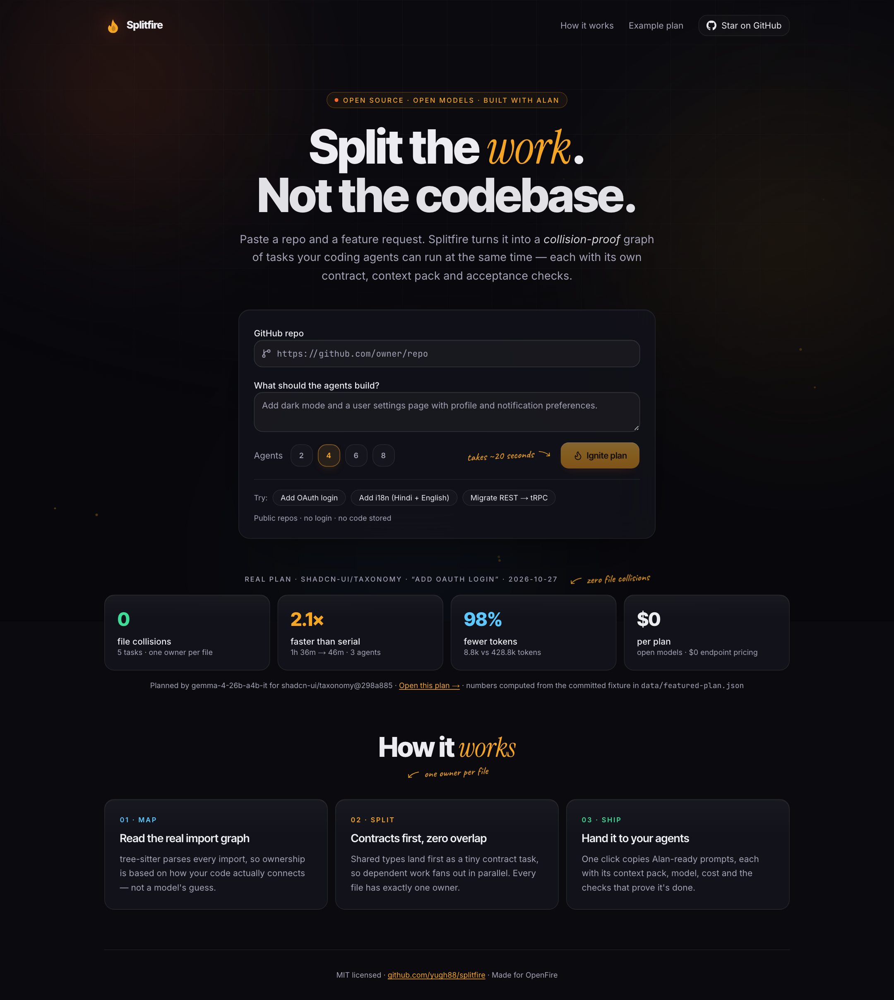
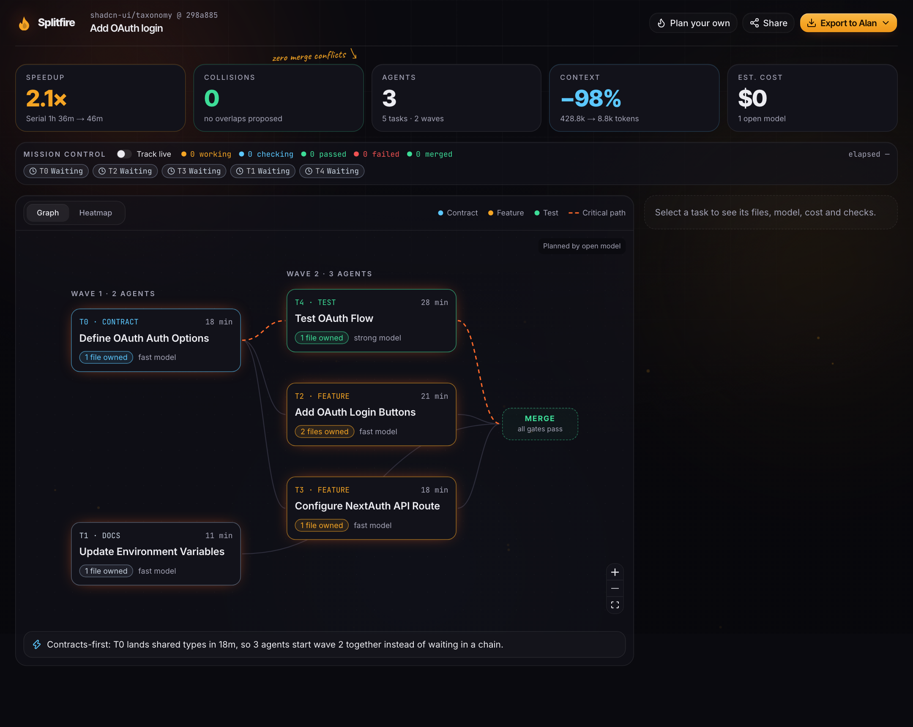
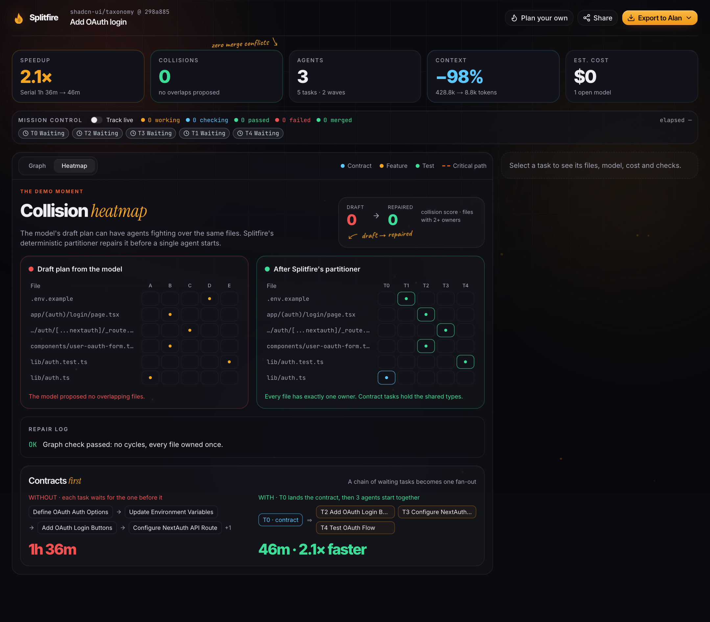

# Splitfire

**Split the work. Not the codebase.**

Paste a GitHub repo and a feature request. Splitfire turns it into a collision-proof graph of tasks
that coding agents can run at the same time — each with its own contract, context pack, model, cost
estimate and acceptance checks.

[Live demo](https://splitfire-one.vercel.app) · [Example plan](https://splitfire-one.vercel.app/p/43e1f368e8a2c689)



## The problem

Running several coding agents on one repo fails in four ways:

- **Merge conflicts.** Two agents edit the same file.
- **Idle agents.** Task B waits for task A, so parallelism collapses into a queue.
- **Context bloat.** Every agent reads the whole repo: slow, expensive, and weak on open models.
- **No proof of done.** A human still has to check every result.

Splitfire plans around all four before a single agent starts.

## A real plan

These numbers come from an actual `POST /api/plan` call with an open model, not a mock. The plan
targets [`shadcn-ui/taxonomy`](https://github.com/shadcn-ui/taxonomy) at commit
`298a885` and asks for "Add OAuth login" with four agents.

| Result          | Value                                                 |
| --------------- | ----------------------------------------------------- |
| Tasks           | 5, across 3 agents                                    |
| File collisions | **0** — every file has exactly one owner              |
| Schedule        | **1h 36m serial → 46m parallel (2.1×)**               |
| Context         | **8.8k tokens** with packs vs **428.8k** for the repo |
| Cost            | **$0.00** — open-model endpoint priced at $0          |
| Critical path   | `auth-contract → oauth-integration-test`              |
| Planner         | `gemma-4-26b-a4b-it`, planner mode `llm`              |

Every number is rendered from the committed fixture in `data/featured-plan.json`; regenerate the
fixture instead of editing the stats by hand. The full plan is a read-only share page:
<https://splitfire-one.vercel.app/p/43e1f368e8a2c689>.



Contracts run first, then dependent work fans out. The heatmap shows what the model's draft got
wrong and what the deterministic repair fixed:



## How it works


1. **Map.** tree-sitter parses every import, so ownership follows how the code actually connects.
2. **Split.** Deterministic code assigns each file exactly one owner, inserts a small contract task
   ahead of shared types, repairs overlaps and cycles, and schedules the critical path.
3. **Ship.** Each task gets a context pack, a model, a cost estimate and acceptance checks. Copy an
   Alan-ready prompt, download the `.splitfire/` pack, or export the plan JSON.

**Deterministic core, LLM on the edges.** Parsing, partitioning, collision checks, contracts and the
critical path are plain, unit-tested functions. The model only _proposes_ groupings; code verifies
and repairs them. Every model answer passes Zod plus a DAG check. On failure: one retry with the
error, then the fallback model, then a deterministic plan built from import-graph communities.

Repos are cached by commit SHA and plan ids are `hash(repo, sha, request, agents, settingsVersion)`,
so repeating a request replays the stored plan for free. No source code is stored — only the plan.

## What ships

- **Repo ingest** — public GitHub repos via REST, no clone; vendored, generated and lock files are
  skipped, and files are capped at 500 / 2 MB.
- **Real import graph** — tree-sitter (WASM) for TS/JS/Python, with a regex fallback.
- **Streaming planner** — tasks appear node by node over SSE, not behind a spinner.
- **Collision-proof partitioning** — one owner per file, automatic repair of overlaps and cycles;
  the heatmap shows the draft's clashes next to the repaired plan.
- **Contracts-first** — shared types and API surfaces become a tiny contract task so a chain of
  waiting work becomes a fan-out. Kept only when it shortens the schedule.
- **Speedup score** — critical path and agent scheduling on every plan.
- **Context packs** — each task gets its owned files plus their direct imports, not the repo.
- **Model routing + cost** — a fast model for easy tasks, the strong model for hard ones, with
  per-task and total estimates.
- **Acceptance gates** — checks generated from the repo's real tooling (vitest/jest/pytest,
  typecheck, build, required files, and "the diff touches only owned files").
- **Launch in Alan** — one panel with a ready-to-paste prompt per task, grouped by wave, so each
  Alan session starts with its branch, owned files and checks.
- **Mission control** — optionally watch `splitfire/<task>` branches and light up each task as it
  moves through working, checking, passed, failed and merged, with a live cost meter.
- **Gate checks in CI** — a generated GitHub Actions workflow runs each task's acceptance checks when
  its `splitfire/<task>` branch is pushed and reports a `splitfire/<task>` check run.
- **Export and share** — copy Alan-ready prompts per task or all at once, download the `.splitfire/`
  pack or plan JSON, and share read-only plans at `/p/<planId>`.
- **CLI** — `splitfire plan "<request>"` plans the repository you are in and writes the same
  `.splitfire/` pack, without uploading file contents.
- **Interactive re-split** — drag a file to another task and the collision score, critical path and
  schedule recompute live; save the edited plan as a new share link.

## Built with Alan and open models

Splitfire was built by parallel Alan agents working on separate `splitfire/*` branches — the same
workflow it plans for you. It also planned part of itself: `.splitfire/plan.json` is Splitfire's own
plan for adding a CLI and interactive re-split, split into five tasks with zero file collisions.

Planning runs on open models through an OpenAI-compatible endpoint. The fixture above was produced
by `gemma-4-26b-a4b-it`; a smaller model handles easy tasks and a fallback endpoint is tried before
the deterministic planner.

## Quick start

Requires Node 20+.

```sh
git clone https://github.com/yugh88/splitfire && cd splitfire
npm install
cp .env.example .env.local
npm run dev
```

Open <http://localhost:3000>. `.env.example` ships with `MOCK_LLM=1`, so the UI works with fixture
plans and no keys. For real plans, set `MOCK_LLM=0` and point it at any OpenAI-compatible open-model
endpoint (see [Configuration](#configuration)). With no model configured, Splitfire plans
deterministically and labels the plan as such.

A `GITHUB_TOKEN` is optional; it raises GitHub's 60-requests-per-hour anonymous limit. Upstash Redis
is optional too — without it, plans, rate limits and spend live in memory.

## CLI

Plan a repo from a terminal. The CLI runs the same ingest, planner, partitioning and gates as the
web app, then writes the pack. It is not published to npm yet, so run it from a clone:

```sh
# inside the splitfire clone: plan this repo, or any GitHub repo with --repo
npx splitfire plan "Add task due dates and email reminders" --agents 4
npx splitfire plan "Add OAuth login" --repo shadcn-ui/taxonomy

# from any other repository on your machine
node /path/to/splitfire/bin/splitfire.mjs plan "Add task due dates and email reminders"
```

Run `npm link` once in the clone to get a global `splitfire` command instead. The CLI writes:

```
.splitfire/README.md                    plan overview
.splitfire/plan.json                    manifest: tasks, owners, dependencies, schedule, costs
.splitfire/tasks/*.md                   one prompt per task, with its acceptance checks
.github/workflows/splitfire-gates.yml   runs each task's checks on its splitfire/<task> branch
```

| Option      | Default      | Purpose                                             |
| ----------- | ------------ | --------------------------------------------------- |
| `--repo`    | current dir  | Plan a GitHub repo instead (`owner/name` or a URL)  |
| `--agents`  | `2`          | Number of parallel agents to schedule for           |
| `--out`     | `.splitfire` | Pack directory                                      |
| `--mock`    | off          | Skip model calls; use the deterministic planner     |
| `--offline` | off          | Never touch the network; deterministic planner only |

Local mode is the default and reads files from disk, honouring `.gitignore` and the same skip rules
as ingest. File contents never leave the machine: only paths, the import graph and the request can
reach the model, and `--offline` sends nothing at all. `splitfire --help` prints the full usage.

## Configuration

| Variable                                                  | Purpose                                                              |
| --------------------------------------------------------- | -------------------------------------------------------------------- |
| `OPENMODEL_BASE_URL`, `OPENMODEL_API_KEY`                 | Primary OpenAI-compatible open-model endpoint                        |
| `PLANNER_MODEL`, `FAST_MODEL`                             | Strong and small model ids                                           |
| `FALLBACK_BASE_URL`, `FALLBACK_API_KEY`, `FALLBACK_MODEL` | Fallback endpoint                                                    |
| `MODEL_PRICES_JSON`                                       | USD per 1M tokens per model, e.g. `{"m":{"input":0.6,"output":2.4}}` |
| `CREDIT_BUDGET_USD`, `PLAN_MAX_COST_USD`                  | Total and per-plan spend caps (defaults `5` and `0.05`)              |
| `MOCK_LLM`                                                | `1` = fixture plans, no model calls                                  |
| `UPSTASH_REDIS_REST_URL`, `UPSTASH_REDIS_REST_TOKEN`      | Plan store, cache, spend and rate limits (in-memory if unset)        |
| `KV_REST_API_URL`, `KV_REST_API_TOKEN`                    | Same, under the names the Vercel Upstash integration sets            |
| `GITHUB_TOKEN`                                            | Optional; raises the GitHub rate limit                               |

The live demo runs on **Gemma 4** (open weights) through the Gemini API's OpenAI-compatible
endpoint, free tier:

```sh
OPENMODEL_BASE_URL=https://generativelanguage.googleapis.com/v1beta/openai
OPENMODEL_API_KEY=<your Gemini API key>
PLANNER_MODEL=gemma-4-26b-a4b-it
FAST_MODEL=gemma-4-26b-a4b-it
FALLBACK_BASE_URL=https://generativelanguage.googleapis.com/v1beta/openai
FALLBACK_API_KEY=<your Gemini API key>
FALLBACK_MODEL=gemma-4-31b-it
MODEL_PRICES_JSON={"gemma-4-26b-a4b-it":{"input":0,"output":0},"gemma-4-31b-it":{"input":0,"output":0}}
```

Gemma streams its reasoning as ordinary text, so `lib/plan/llm.ts` filters it out of the stream
before the JSON is parsed, and turns off JSON mode for Gemma (the prompt still fixes the shape and
Zod still validates it). Any other OpenAI-compatible provider needs no special handling.

**Credit guards.** Before every model call the worst-case cost is checked against both caps using
`MODEL_PRICES_JSON`; a call that could exceed them is not made, and unpriced models are never
called. Real usage is recorded after each call. At 90% of the budget every call switches to
`FAST_MODEL`; at 100% the deterministic planner takes over. The app is also limited to 5 plans per
IP per hour. `GET /api/health` reports spend and the current mode (numbers only, no secrets).

## API

- `POST /api/plan` with `{ "repo": "owner/repo", "request": "...", "agents": 4 }` streams SSE:
  `ingested`, `graph`, `task`, `partitioned`, `metrics`, `done`, `error`.
- `GET /api/health` returns spend, budget and the planning mode.
- `GET /api/track/<planId>` returns live `splitfire/*` branch status for a stored plan.
- `POST /api/share` stores an edited (re-split) plan and returns its share id.
- `/p/<planId>` is the read-only share page.

## Development

```sh
npm run lint          # ESLint
npm run typecheck     # tsc --noEmit
npm test              # Vitest unit tests
npm run test:e2e      # Playwright: main flow + re-split (mock dev server, or set E2E_BASE_URL)
npm run format:check  # Prettier
```

CI runs lint, format check, typecheck and unit tests on every push to `main`; the **Splitfire
gates** workflow runs task checks on `splitfire/**` branches. Pushes to `main` deploy to Vercel.

```
app/              routes: /, /p/[id], /api/plan, /api/health, /api/share, /api/track/[id]
components/       landing, plan screen, graph, task cards, heatmap, re-split, mission control, launch
hooks/            plan stream and media-query hooks
lib/              ingest/ analyze/ plan/ partition/ context/ cost/ gates/ track/ store/ client/
lib/types.ts      core types shared by every module
cli/, bin/        the splitfire CLI and its launcher
tests/, e2e/      Vitest unit tests with a fixture repo; Playwright end-to-end tests
data/             featured-plan.json — the real plan behind the landing stats
docs/             screenshots used in this README
.splitfire/       Splitfire's own plan for its CLI and re-split features
```

## Known limits

v1 guarantees no _file_ overlap between tasks. Semantic conflicts — two tasks changing behaviour the
other relies on — are caught by the acceptance gates, not prevented. Repos larger than ~500 source
files or 2 MB are planned from a deterministic subset (core source first). Free-tier open-model
endpoints rate-limit; Splitfire retries transient errors, tries the fallback model, then uses the
deterministic planner, all within a fixed planning deadline. The CLI is not on npm yet.

## License

[MIT](LICENSE)
